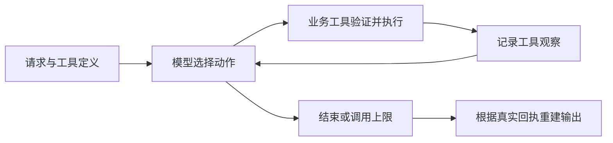

# 02 方案与取舍

## 调用流程

执行器把请求与工具定义交给决策器。决策器每次选择一个工具动作，执行器保存工具结果并返回给决策器，直到选择结束或到达调用上限。真实模式由模型的 function calling 选择动作；离线模式使用明确标记的规则 Mock。

工具有四个：

| 工具 | 职责 |
| --- | --- |
| `read_material` | 读取请求内的素材，报告元数据与缺失项 |
| `check_rules` | 检查必填字段、版权状态与合成阻断规则 |
| `query_slots` | 查询候选时段、已有排期及其他草稿占用 |
| `save_draft` | 复验前置条件、规则和冲突，在事务中防重复保存 |

## 动态决策与证据

正常路径可在检查通过后保存所需时段。发生冲突时，决策器观察查询结果，再查询替代时段并保存待确认草稿；发现缺失或规则风险时停止并报告原因。工具失败时，决策器应根据实际观察重试、调整或停止，已成功步骤的结果仍保留。

这些是待验证的行为要求，不是预填的决策日志。每条 Trace 从当次执行生成。离线 Mock 也会读取工具结果选择下一步，但其规则分支只能用于流程验证；它不构成真实模型 ReAct 达标证据。

## 不能交给提示词的边界

`save_draft` 自行验证素材属于请求、必要工具已成功执行、规则允许保存、候选时段已查询且当前无冲突。模型不能通过传入“已确认”标记获得权限。硬性要求的替代时段只有与首次请求中的明确确认匹配时才能标为 `confirmed`，否则保留 `pending_confirmation`，原始要求保持不变。

执行器从工具回执重建最终状态。模型说“完成”不能让失败工具变为成功，也不能把草稿描述为发布。执行次数受到上限控制；达到上限返回未完成。

## 持久化与幂等

SQLite 事务承担保存和并发互斥。`(request_id, asset_id)` 唯一约束与业务参数指纹共同防止重复提交；相同请求返回原草稿，改变参数则返回幂等冲突。保存时再次读取当前资料和占用状态，避免仅凭早先查询结果落库。其他草稿包括待确认草稿都暂占其建议时段。

幂等重放返回的是已有保存回执，不保证资料或占用从未发生变化。调用方要改变业务请求时需使用新的请求 ID，并重新审核；原有草稿仍暂占其时段。

当前没有草稿变更工具。给旧请求增加 `confirmed_alternative_at` 会产生幂等冲突；换新请求 ID 也不能绕过原草稿的占用。这是有意保留的边界：不能把重放当作修改，且需要独立的确认、取消与审计设计才能安全推进已有草稿。输入中的确认仅覆盖首次请求已获同意的路径，不代表实现了确认续跑。

## 技术取舍

Python 3.12 标准库提供 CLI、JSON、HTTP 和 SQLite，不引入框架。这样能把时间集中在决策循环、权限边界和可复现验证上。真实接口采用 OpenAI-compatible Chat Completions 工具调用，便于更换支持 function calling 的模型，但不同服务的兼容性仍须实测。

本项目没有采用 Agent 框架，也没有生产发布能力。单机 SQLite 和本地 JSON 适合考核规模；多实例服务、身份认证、人工确认 UI、审计留存和生产级并发属于后续工程工作。
